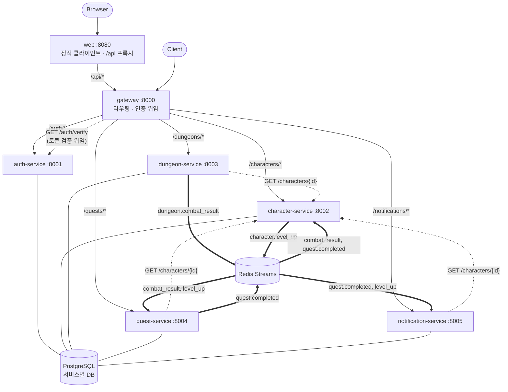
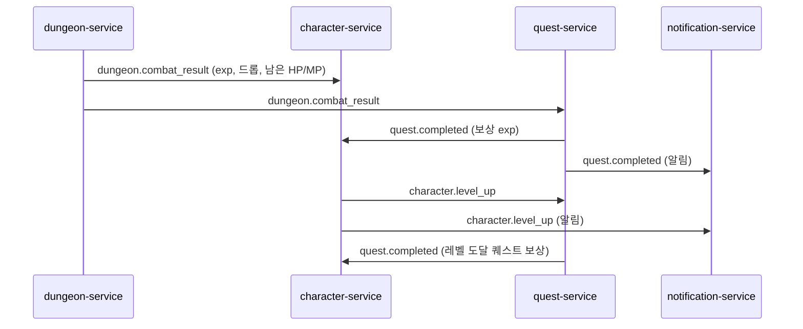

# 던전 크롤러 텍스트 RPG — MSA 학습 프로젝트

FastAPI 기반 마이크로서비스로 만든 텍스트 던전 크롤러 RPG 백엔드입니다.
게임 완성도보다 **MSA 패턴 학습**(서비스 분리, API Gateway, 이벤트 기반 통신)이 목적입니다.

- 기획/설계/규칙 상세: [기획서_및_계획서.md](기획서_및_계획서.md)
- 작업 규칙: [CLAUDE.md](CLAUDE.md)

## 아키텍처



| 서비스 | 포트 | 책임 | DB |
|---|---|---|---|
| web | 8080 | 웹 클라이언트(HTML/CSS/JS) 서빙, `/api/*`를 Gateway로 프록시 | - |
| gateway | 8000 | 라우팅, JWT 검증을 auth-service에 위임, `X-User-Id` 부착 | - |
| auth-service | 8001 | 회원가입, 로그인(JWT 발급), 토큰 검증(내부용) | `auth_db` |
| character-service | 8002 | 캐릭터·스탯·인벤토리, 휴식 / 전투 결과·퀘스트 보상 반영 | `character_db` |
| dungeon-service | 8003 | 던전 입장, 턴제 전투(세션은 Redis) | `dungeon_db` |
| quest-service | 8004 | 퀘스트 수락·진행도 추적 | `quest_db` |
| notification-service | 8005 | 퀘스트 완료·레벨업 알림 저장/조회 | `notification_db` |
| postgres | 5432 | 컨테이너 1개, 서비스별 DB와 전용 계정 | |
| redis | 6379 | 이벤트 버스(Streams), 전투 세션 저장 | |

### 통신 원칙
- **동기(HTTP)**: 클라이언트에 즉시 응답이 필요한 경우 (로그인, 캐릭터 조회, 입장 시 스탯 조회)
- **비동기(Redis Streams)**: 한 서비스의 상태 변화가 다른 서비스의 상태 변화를 일으키는 경우. 전투 결과는 **HTTP 호출 없이 이벤트로만** 전파된다
- 서비스는 자기 DB에만 접근하고, 서비스 간 코드를 import하지 않는다 (`shared/events.py`의 이벤트 스키마만 공유)

### 이벤트 흐름
전투 한 번이 서비스 사이를 연쇄적으로 흐릅니다.



- Consumer Group: `{service-name}-group`, 이벤트마다 `event_id`로 멱등 처리
- 서비스가 꺼져 있어도 이벤트는 스트림에 남고, 재시작하면 이어서 처리한다

### 신뢰성 장치 (최소 한 번 전달 + 멱등 소비)
| 장치 | 해결하는 문제 |
|---|---|
| **Transactional Outbox** (character/quest) | DB는 커밋됐는데 이벤트 발행이 실패해 유실되는 문제. 이벤트를 같은 트랜잭션으로 `outbox` 테이블에 쓰고 릴레이가 발행 |
| **Redis `MULTI`** (dungeon) | 전투 종료 이벤트 발행과 세션 삭제 중 하나만 반영되는 문제 |
| **XAUTOCLAIM** | 처리 도중 죽은 인스턴스가 쥐고 있던 메시지가 영영 처리되지 않는 문제. 30초 이상 방치된 pending 메시지를 다른 인스턴스가 회수해 재시도 |
| **DLQ** | 계속 실패하는 메시지가 무한 재시도되거나 버려지는 문제. 3회 실패 또는 파싱/스키마 오류 시 `{stream}.dlq`로 격리 |

DLQ 확인과 재처리 (디버그 오버레이로 Redis 포트가 열려 있어야 함):

```bash
uv run tools/dlq.py list
```

```bash
uv run tools/dlq.py redrive dungeon.combat_result.dlq
```

## 빠른 시작

```bash
cp .env.example .env
```

```bash
docker compose up --build -d
```

```bash
curl localhost:8000/health
```

브라우저에서 **http://localhost:8080** 을 열면 웹 클라이언트로 바로 플레이할 수 있습니다.

기동 시 각 서비스가 `alembic upgrade head`로 스키마와 시드 데이터(던전·몬스터·아이템·퀘스트)를 만듭니다.

> 이전 버전으로 만든 Postgres 볼륨을 쓰고 있다면 새 서비스의 DB가 없습니다. 초기화 스크립트는 여러 번 실행해도 안전하니 한 번 실행하세요:
> `docker compose exec postgres bash /docker-entrypoint-initdb.d/init-databases.sh`

호스트에는 **웹 클라이언트(8080)와 Gateway(8000)만** 열립니다. 내부 서비스의 Swagger(`http://localhost:800{1..5}/docs`)나 Redis에 직접 접근하려면 디버그 오버레이를 함께 씁니다:

```bash
docker compose -f docker-compose.yml -f docker-compose.debug.yml up --build -d
```

컨슈머 서비스는 여러 인스턴스로 늘릴 수 있습니다 (디버그 오버레이 없이):

```bash
docker compose up -d --scale character-service=2 --scale quest-service=2
```

## 웹 클라이언트

`web/`은 빌드 없는 HTML/CSS/JS 한 페이지를 nginx로 서빙합니다. 브라우저는 같은 출처의 `/api/*`만 호출하고, nginx가 이를 Gateway로 넘깁니다 (CORS 설정 불필요, 백엔드 변경 없음).

- 로그인/회원가입 → 캐릭터 선택·생성 → 게임 화면 (캐릭터·인벤토리 / 던전·턴제 전투 / 퀘스트·알림)
- 전투가 끝나면 "반영 중…"을 띄우고, 이벤트로 캐릭터·퀘스트·알림이 갱신될 때까지 다시 조회합니다 (최종적 일관성을 화면에서 확인)
- 하단에 마지막 요청의 `X-Request-ID`가 표시되어, 이 값으로 서버 로그를 추적할 수 있습니다

## 플레이 예시 (Gateway만 사용)

```bash
G=localhost:8000; J='Content-Type: application/json'
curl -s -X POST $G/auth/register -H "$J" -d '{"username":"hero","password":"password123"}'
TOKEN=$(curl -s -X POST $G/auth/login -H "$J" -d '{"username":"hero","password":"password123"}' | python -c "import sys,json;print(json.load(sys.stdin)['access_token'])")
A="Authorization: Bearer $TOKEN"

curl -s -X POST $G/characters -H "$J" -H "$A" -d '{"name":"Aria"}'            # 캐릭터 생성 (id=1 가정)
curl -s -X POST $G/quests/1/accept -H "$J" -H "$A" -d '{"character_id":1}'    # 퀘스트 수락
curl -s -X POST $G/dungeons/1/enter -H "$J" -H "$A" -d '{"character_id":1}'   # 던전 입장
curl -s -X POST $G/dungeons/1/combat -H "$J" -H "$A" -d '{"character_id":1,"action":"attack"}'  # 1턴 (반복)
curl -s $G/characters/1 -H "$A"                                              # 이벤트로 반영된 스탯
curl -s "$G/quests/progress?character_id=1" -H "$A"                          # 퀘스트 진행도
curl -s -X POST $G/characters/1/rest -H "$A"                                 # 휴식 (HP/MP 회복)
curl -s "$G/notifications?character_id=1" -H "$A"                            # 알림 (퀘스트 완료·레벨업)
```

## API 요약 (Gateway 경로)

| 메서드 | 경로 | 설명 | 인증 |
|---|---|---|---|
| POST | `/auth/register` | 회원가입 | - |
| POST | `/auth/login` | 로그인, JWT 발급 | - |
| POST | `/characters` | 캐릭터 생성 | 필요 |
| GET | `/characters` | 내 캐릭터 목록 | 필요 |
| GET | `/characters/{id}` | 캐릭터 조회 | 필요 |
| GET | `/characters/{id}/inventory` | 인벤토리 | 필요 |
| POST | `/characters/{id}/rest` | 휴식 (HP/MP 전부 회복) | 필요 |
| GET | `/dungeons` | 던전 목록 | 필요 |
| POST | `/dungeons/{id}/enter` | 입장, 몬스터와 전투 시작 | 필요 |
| POST | `/dungeons/{id}/combat` | 1턴 진행 (`attack`/`defend`/`skill`/`flee`) | 필요 |
| GET | `/quests` | 퀘스트 목록 | 필요 |
| POST | `/quests/{id}/accept` | 퀘스트 수락 | 필요 |
| GET | `/quests/progress?character_id=` | 퀘스트 진행도 | 필요 |
| GET | `/notifications?character_id=&unread_only=` | 알림 목록 (최신순) | 필요 |
| POST | `/notifications/{id}/read` | 알림 읽음 처리 | 필요 |

모든 에러는 `{"error": {"code": "...", "message": "..."}}` 형식입니다.
전투 규칙은 기획서 4.4.1, 퀘스트 규칙은 4.5.1에 있습니다.

## 관측성 (로그와 요청 추적)

- 모든 서비스가 **한 줄에 JSON 하나**로 로그를 남깁니다: `ts`, `level`, `service`, `logger`, `correlation_id`, `msg`, 그 외 필드
- **Correlation ID**
  - Gateway가 `X-Request-ID`를 만들거나(클라이언트가 보내면 그대로 사용) 응답 헤더로 돌려줍니다
  - 서비스 간 HTTP 호출에 `X-Request-ID` 헤더로 전파됩니다
  - 이벤트에는 `correlation_id` 필드로 담기고, 연쇄 이벤트(`quest.completed`, `level_up`)에도 이어집니다

요청 하나의 전체 흐름을 모든 서비스 로그에서 찾으려면:

```bash
docker compose logs --no-log-prefix | grep '"correlation_id": "<X-Request-ID 값>"'
```

## 테스트

서비스별 단위 테스트 (DB는 인메모리 SQLite, Redis는 fakeredis, 다른 서비스는 가짜 HTTP로 대체):

```bash
for d in gateway auth-service character-service dungeon-service quest-service notification-service; do (cd "$d" && uv run pytest); done
```

엔드투엔드 테스트 (실행 중인 스택에 Gateway로만 붙어서 검증, 스택이 없으면 skip):

```bash
cd e2e && uv run pytest
```

## 디렉토리 구조

```
├── docker-compose.yml
├── docker-compose.debug.yml           # 내부 서비스·Redis 포트를 여는 디버그 오버레이
├── web/                               # 웹 클라이언트 (nginx + public/{index.html,style.css,app.js})
├── .env.example
├── tools/dlq.py                       # DLQ 확인/재처리 도구 (uv run)
├── infra/postgres/init-databases.sh   # 서비스별 DB/계정 생성
├── shared/events.py                   # 이벤트 스키마 (서비스 간 유일한 공유 코드)
├── gateway/
├── auth-service/                      # 서비스 공통 구조:
├── character-service/                 #   app/{main,routes,schemas,models,db,errors,observability}.py
│                                      #   (+ 구독: consumer.py·handlers.py, 발행: outbox.py)
├── dungeon-service/                   #   alembic/, tests/, pyproject.toml, uv.lock, Dockerfile
├── quest-service/
├── notification-service/
└── e2e/                               # 엔드투엔드 테스트 (독립 uv 프로젝트)
```

## 기술 스택
Python 3.12 · FastAPI · SQLAlchemy 2 (async, asyncpg) · Alembic · PostgreSQL 16 · Redis 7 (Streams) · httpx · python-jose · uv · Docker Compose · pytest

## 알려진 한계
- 전투 직후 바로 재입장하면 이벤트가 아직 반영되지 않아 이전 HP로 시작할 수 있다 (최종적 일관성)
- 발행된 outbox 행과 `processed_events`는 정리(보존 기간 삭제)하지 않는다
- 스케일을 줄이거나 컨테이너를 재생성하면 사라진 컨슈머 이름이 Consumer Group에 남는다 (pending은 XAUTOCLAIM으로 회수되므로 동작에는 영향 없음)
- 디버그 오버레이를 쓰면 내부 서비스 포트가 열려 Gateway를 우회할 수 있다

남은 확장 과제는 기획서 "Phase 5 — 확장 과제"를 참고하세요.
