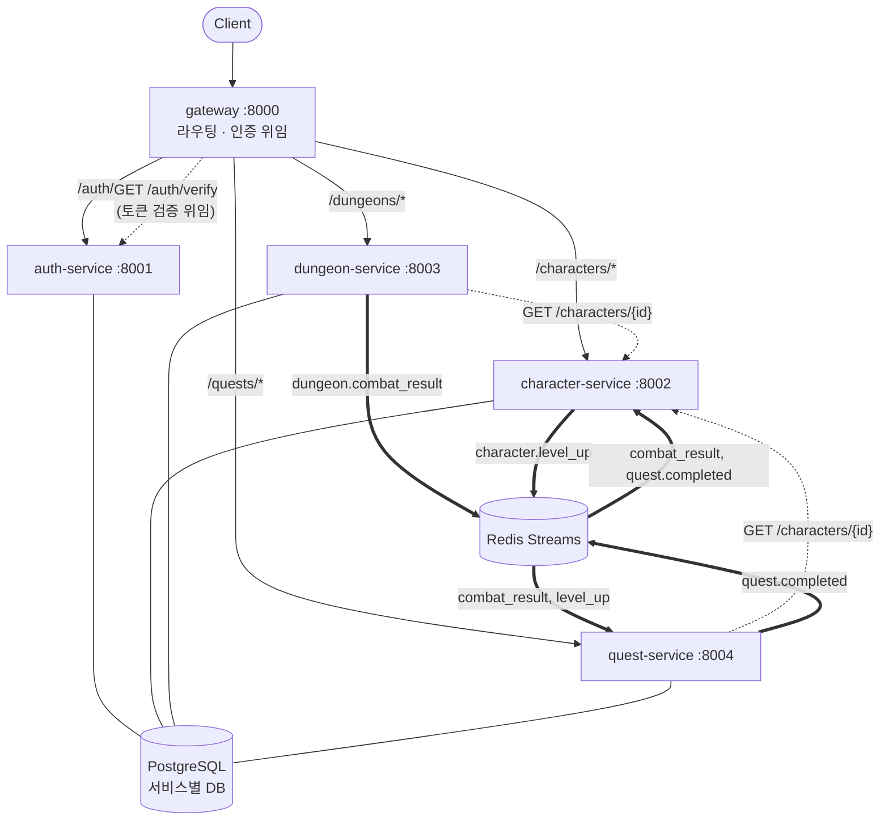
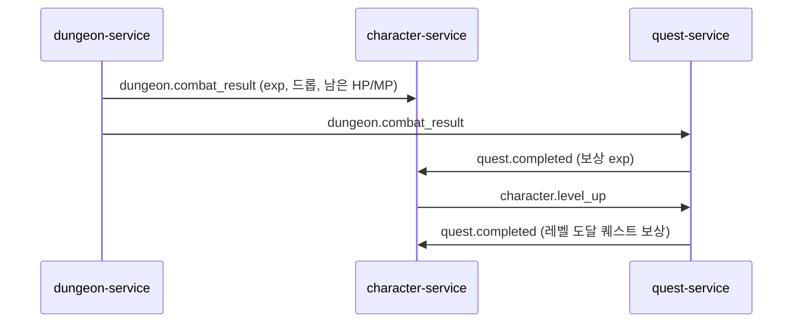

# 던전 크롤러 텍스트 RPG — MSA 학습 프로젝트

FastAPI 기반 마이크로서비스로 만든 텍스트 던전 크롤러 RPG 백엔드입니다.
게임 완성도보다 **MSA 패턴 학습**(서비스 분리, API Gateway, 이벤트 기반 통신)이 목적입니다.

- 기획/설계/규칙 상세: [기획서_및_계획서.md](기획서_및_계획서.md)
- 작업 규칙: [CLAUDE.md](CLAUDE.md)

## 아키텍처



| 서비스 | 포트 | 책임 | DB |
|---|---|---|---|
| gateway | 8000 | 라우팅, JWT 검증을 auth-service에 위임, `X-User-Id` 부착 | - |
| auth-service | 8001 | 회원가입, 로그인(JWT 발급), 토큰 검증(내부용) | `auth_db` |
| character-service | 8002 | 캐릭터·스탯·인벤토리, 휴식 / 전투 결과·퀘스트 보상 반영 | `character_db` |
| dungeon-service | 8003 | 던전 입장, 턴제 전투(세션은 Redis) | `dungeon_db` |
| quest-service | 8004 | 퀘스트 수락·진행도 추적 | `quest_db` |
| postgres | 5432 | 컨테이너 1개, 서비스별 DB와 전용 계정 | |
| redis | 6379 | 이벤트 버스(Streams), 전투 세션 저장 | |

### 통신 원칙
- **동기(HTTP)**: 클라이언트에 즉시 응답이 필요한 경우 (로그인, 캐릭터 조회, 입장 시 스탯 조회)
- **비동기(Redis Streams)**: 한 서비스의 상태 변화가 다른 서비스의 상태 변화를 일으키는 경우. 전투 결과는 **HTTP 호출 없이 이벤트로만** 전파된다
- 서비스는 자기 DB에만 접근하고, 서비스 간 코드를 import하지 않는다 (`shared/events.py`의 이벤트 스키마만 공유)

### 이벤트 흐름
전투 한 번이 서비스 사이를 연쇄적으로 흐릅니다.



- Consumer Group: `{service-name}-group`, 이벤트마다 `event_id`로 멱등 처리
- 서비스가 꺼져 있어도 이벤트는 스트림에 남고, 재시작하면 이어서 처리한다

## 빠른 시작

```bash
cp .env.example .env
```

```bash
docker compose up --build -d
```

```bash
curl localhost:8000/health
```

기동 시 각 서비스가 `alembic upgrade head`로 스키마와 시드 데이터(던전·몬스터·아이템·퀘스트)를 만듭니다.
Swagger 문서는 서비스별로 `http://localhost:800{1..4}/docs`에서 볼 수 있습니다.

## 플레이 예시 (Gateway만 사용)

```bash
G=localhost:8000; J='Content-Type: application/json'
curl -s -X POST $G/auth/register -H "$J" -d '{"username":"hero","password":"password123"}'
TOKEN=$(curl -s -X POST $G/auth/login -H "$J" -d '{"username":"hero","password":"password123"}' | python -c "import sys,json;print(json.load(sys.stdin)['access_token'])")
A="Authorization: Bearer $TOKEN"

curl -s -X POST $G/characters -H "$J" -H "$A" -d '{"name":"Aria"}'            # 캐릭터 생성 (id=1 가정)
curl -s -X POST $G/quests/1/accept -H "$J" -H "$A" -d '{"character_id":1}'    # 퀘스트 수락
curl -s -X POST $G/dungeons/1/enter -H "$J" -H "$A" -d '{"character_id":1}'   # 던전 입장
curl -s -X POST $G/dungeons/1/combat -H "$J" -H "$A" -d '{"character_id":1,"action":"attack"}'  # 1턴 (반복)
curl -s $G/characters/1 -H "$A"                                              # 이벤트로 반영된 스탯
curl -s "$G/quests/progress?character_id=1" -H "$A"                          # 퀘스트 진행도
curl -s -X POST $G/characters/1/rest -H "$A"                                 # 휴식 (HP/MP 회복)
```

## API 요약 (Gateway 경로)

| 메서드 | 경로 | 설명 | 인증 |
|---|---|---|---|
| POST | `/auth/register` | 회원가입 | - |
| POST | `/auth/login` | 로그인, JWT 발급 | - |
| POST | `/characters` | 캐릭터 생성 | 필요 |
| GET | `/characters` | 내 캐릭터 목록 | 필요 |
| GET | `/characters/{id}` | 캐릭터 조회 | 필요 |
| GET | `/characters/{id}/inventory` | 인벤토리 | 필요 |
| POST | `/characters/{id}/rest` | 휴식 (HP/MP 전부 회복) | 필요 |
| GET | `/dungeons` | 던전 목록 | 필요 |
| POST | `/dungeons/{id}/enter` | 입장, 몬스터와 전투 시작 | 필요 |
| POST | `/dungeons/{id}/combat` | 1턴 진행 (`attack`/`defend`/`skill`/`flee`) | 필요 |
| GET | `/quests` | 퀘스트 목록 | 필요 |
| POST | `/quests/{id}/accept` | 퀘스트 수락 | 필요 |
| GET | `/quests/progress?character_id=` | 퀘스트 진행도 | 필요 |

모든 에러는 `{"error": {"code": "...", "message": "..."}}` 형식입니다.
전투 규칙은 기획서 4.4.1, 퀘스트 규칙은 4.5.1에 있습니다.

## 관측성 (로그와 요청 추적)

- 모든 서비스가 **한 줄에 JSON 하나**로 로그를 남깁니다: `ts`, `level`, `service`, `logger`, `correlation_id`, `msg`, 그 외 필드
- **Correlation ID**
  - Gateway가 `X-Request-ID`를 만들거나(클라이언트가 보내면 그대로 사용) 응답 헤더로 돌려줍니다
  - 서비스 간 HTTP 호출에 `X-Request-ID` 헤더로 전파됩니다
  - 이벤트에는 `correlation_id` 필드로 담기고, 연쇄 이벤트(`quest.completed`, `level_up`)에도 이어집니다

요청 하나의 전체 흐름을 모든 서비스 로그에서 찾으려면:

```bash
docker compose logs --no-log-prefix | grep '"correlation_id": "<X-Request-ID 값>"'
```

## 테스트

서비스별 단위 테스트 (DB는 인메모리 SQLite, Redis는 fakeredis, 다른 서비스는 가짜 HTTP로 대체):

```bash
for d in gateway auth-service character-service dungeon-service quest-service; do (cd "$d" && uv run pytest); done
```

엔드투엔드 테스트 (실행 중인 스택에 Gateway로만 붙어서 검증, 스택이 없으면 skip):

```bash
cd e2e && uv run pytest
```

## 디렉토리 구조

```
├── docker-compose.yml
├── .env.example
├── infra/postgres/init-databases.sh   # 서비스별 DB/계정 생성
├── shared/events.py                   # 이벤트 스키마 (서비스 간 유일한 공유 코드)
├── gateway/
├── auth-service/                      # 서비스 공통 구조:
├── character-service/                 #   app/{main,routes,schemas,models,db,errors,observability}.py
├── dungeon-service/                   #   alembic/, tests/, pyproject.toml, uv.lock, Dockerfile
├── quest-service/
└── e2e/                               # 엔드투엔드 테스트 (독립 uv 프로젝트)
```

## 기술 스택
Python 3.12 · FastAPI · SQLAlchemy 2 (async, asyncpg) · Alembic · PostgreSQL 16 · Redis 7 (Streams) · httpx · python-jose · uv · Docker Compose · pytest

## 알려진 한계와 확장 과제
- 전투 직후 바로 재입장하면 이벤트가 아직 반영되지 않아 이전 HP로 시작할 수 있다 (최종적 일관성)
- DB 커밋 후 이벤트 발행 전에 죽으면 후속 이벤트가 유실될 수 있다 → Outbox 패턴
- 컨슈머 다중 인스턴스 시 죽은 컨슈머의 pending 메시지 회수 → `XAUTOCLAIM`
- 소비 실패 시 로그만 남기고 스킵 → DLQ
- 내부 서비스 포트(8001~8004)는 디버깅용으로 호스트에 열려 있어 Gateway를 우회할 수 있다

자세한 목록은 기획서 "Phase 5 — 확장 과제"를 참고하세요.
